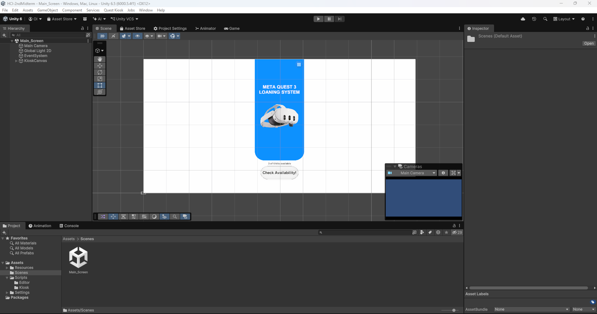
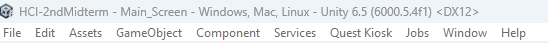
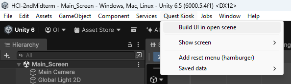
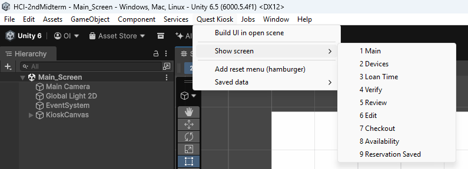
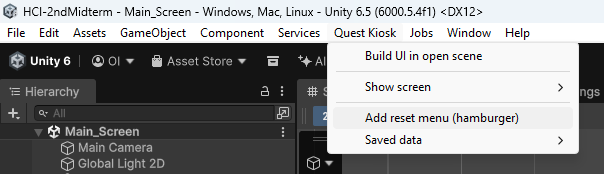
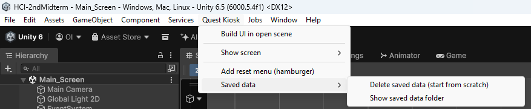
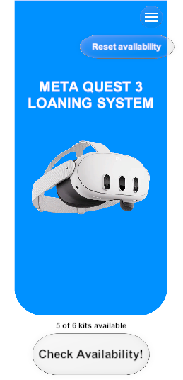

# HCI-2ndMidterm
Repository for the development of a loaning system for MetaQuest3 kits in unity 6000.5.4f1

## Original figma link
https://www.figma.com/design/JpCR3q9DVxC791HaLrxq4d/PartialProject01?node-id=0-1&t=ZmzVELi4CSnkR5tG-1

## Team contributions

### Alvaro David Romero Ramirez
* Main navigation flow
* Edit kit functionality
* Test scenario B
* design.md document

### Gerardo Esquivel Sosa
* Reset app functionality
* Edit demonstration video
* testing.md document
* AI-use.md document

### Omar Alejandro Santos Ibarra
* Style the UI
* Persistence between sessions functionality
* Test scenario A
* Readme.md document

## How to setup the project
> Remember to be working on unity 6000.5.4f1 version

After you open the project, go to **Assets/Scenes** and double click on **Main_Screen** scene. The UI should be completely built.\
 

> In case of the scene isn't built, follow the next steps.

1. On the menu bar, look for the **Quest Kiosk** option.\

2. Click on **Build UI in open scene**.\

3. To navigate between the different screens, click on  **show screens** it will deploy a dropdown menu with all the application screens.\

4. To add the hamburger menu to the main screen and get access to the reset inventory option, click on **add rest menu (hamburger)**.\

5. To reset the application to default click on **Saved data** it deploy a dropdown menu, to reset the application click on **Delete saved data (start from scratch)** also you can get access to the save data folder.\

## Run the Build
Now just click  on the play to run the build on unity, or open the executable file to use the app.

### Test both scenarios
* The project is already set to test the scenario A and scenario B, since by default, has just one kit available to reserve, that will let ou test scenario A. After that, now you can test the scenario B.

### Reset inventory availability
* If you want to reset the inventory to get everything available. Click on the hamburger menu in the main screen and select **Reset availability**\

# Download the app
Download the app from our [Github Release](https://github.com/Santos-OK/HCI-2ndMidterm/releases/tag/v1.0.0)

# Reports
* [Design](docs/design.md)
* [Testing](docs/testing.md)
* [AI-use](docs/ai-use.md)

# Demonstration video
Watch the [Demo video](https://drive.google.com/file/d/1kbumeSXP6Nuy_arCEQGAjL3_ZXPTiotT/view?usp=sharing)
