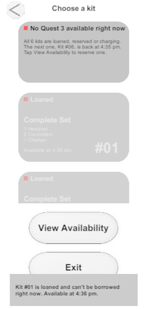

# Design justification

Figma source: https://www.figma.com/design/JpCR3q9DVxC791HaLrxq4d/PartialProject01

## Three interaction decisions

### 1. Every kit shows its status as a color, a word and a time

- **User problem:** a person who sees six grey cards can't tell which kit to take, and can't tell why a kit is not allowed.
  In the Figma every dot was green, even for loaned kits, so color alone said nothing.
- **HCI principle:** visibility of system status (Nielsen 1). The status is not shown by color alone, because the word is always next to the dot.
- **How the design addresses it:** the dot is green, amber, red or blue for Available, Reserved, Loaned and Charging. The word is written next to it.
  Unavailable kits also show "Available at 1:45 pm" and are dimmed. Tapping one shows a message that says what its status is and when it will be free,
  instead of doing nothing.
- **Image:**

### 2. A kit is verified before the request can be reviewed

- **User problem:** a person could borrow a kit that has a missing controller and only find out at the locker.
- **HCI principle:** error prevention (Nielsen 5) and help to recognize and recover from errors (Nielsen 9).
- **How the design addresses it:** the Verify screen checks 1 headset, 2 controllers and 1 charger. Each item says "Verified", "MISSING" or "Only 1 found".
  If something is missing, a red message names the missing part, the **Review Request** button is not shown, and the only action is **Choose another kit**.
  The chosen duration is kept. The same check runs again when the loan is confirmed, so a kit can never be double-loaned.
- **Image:**

### 3. When no kit is free, the kiosk explains why and offers a working next step

- **User problem:** an empty list with no explanation makes people think the kiosk is broken or leave without knowing when to come back.
- **HCI principle:** visibility of system status (Nielsen 1) and user control and freedom (Nielsen 3).
- **How the design addresses it:** the list starts with a banner: "No Quest 3 available right now", the reason (all kits are loaned, reserved or charging) and when the next kit is back.
  **View Availability** lists every kit with its return time and a **Reserve at 1:45 pm** button. A reservation is recorded, the button becomes
  "Reserved for you", and when the kit is free it is held for 15 minutes. **Exit** returns to the start.

- **Image:**

## Figma compared with Unity

| Figma (Project 01) | Unity | Why it changed |
|---|---|---|
| All status dots were green | Dot color depends on the status, with the word kept | Decision 1. Color alone was misleading. |
| Device list was a static picture | The list scrolls and unavailable kits can be tapped for an explanation | Six cards don't fit in 874 px. Implementation need. |
| No way back on most screens | **< Back** on each step and **Back to Review** on Edit | User control and freedom. A kiosk user must be able to undo a step. |
| "Go to: Locker #03" was fixed text | The locker follows the kit (kit #02 → Locker #02) | The assignment asks for the correct pickup location. |
| Return deadline was fixed text ("5:30 pm") | Deadline = confirmation time + chosen minutes | The assignment asks for the correct return deadline. |
| Duration list showed "Select duration..." | Same, and **Verify Kit** only appears after a choice | Avoids moving forward without a duration. |
| Pencil icon to edit the request | A small **Edit** button | The pencil image was not exported. A word is also clearer. |
| Main screen had only the title and the button | Adds "2 of 6 kits available" | Shows the state before the person taps. |
| No final button on the pickup screen | **Done** returns to the start | The next person must start from a clean screen. |

